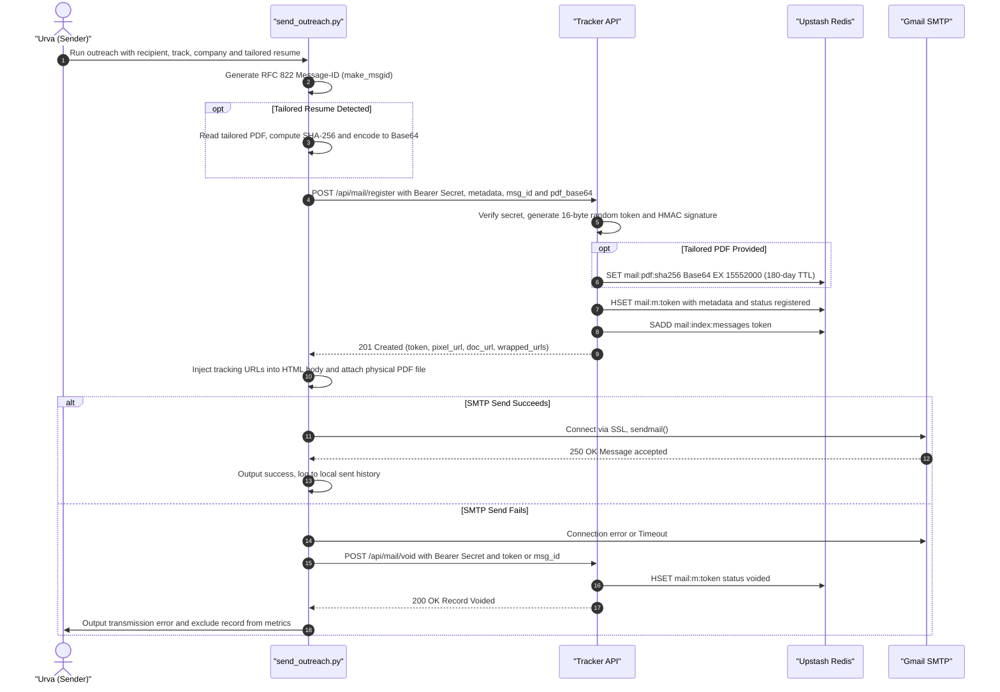
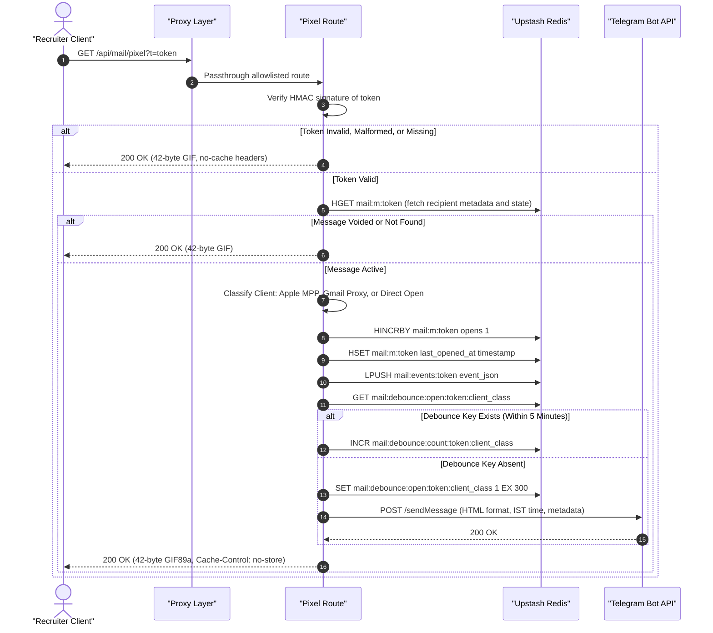
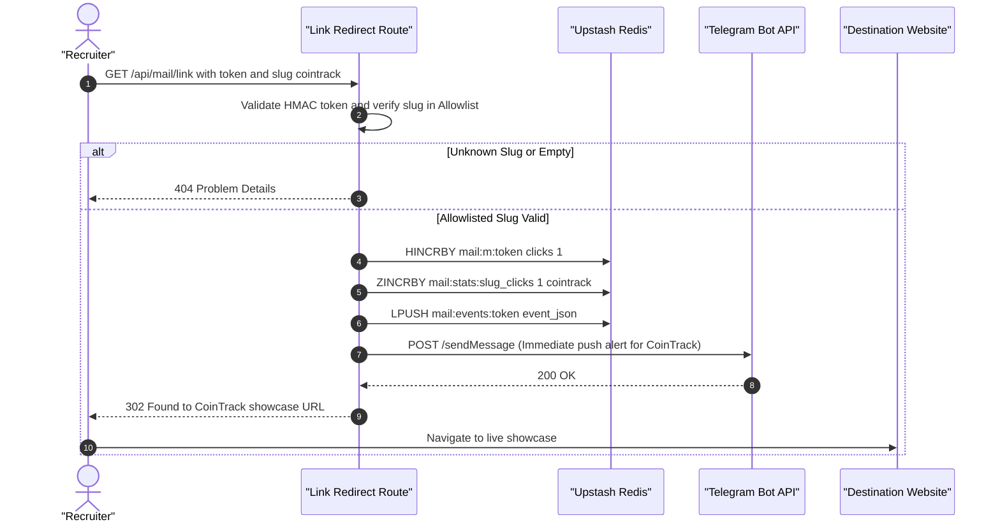
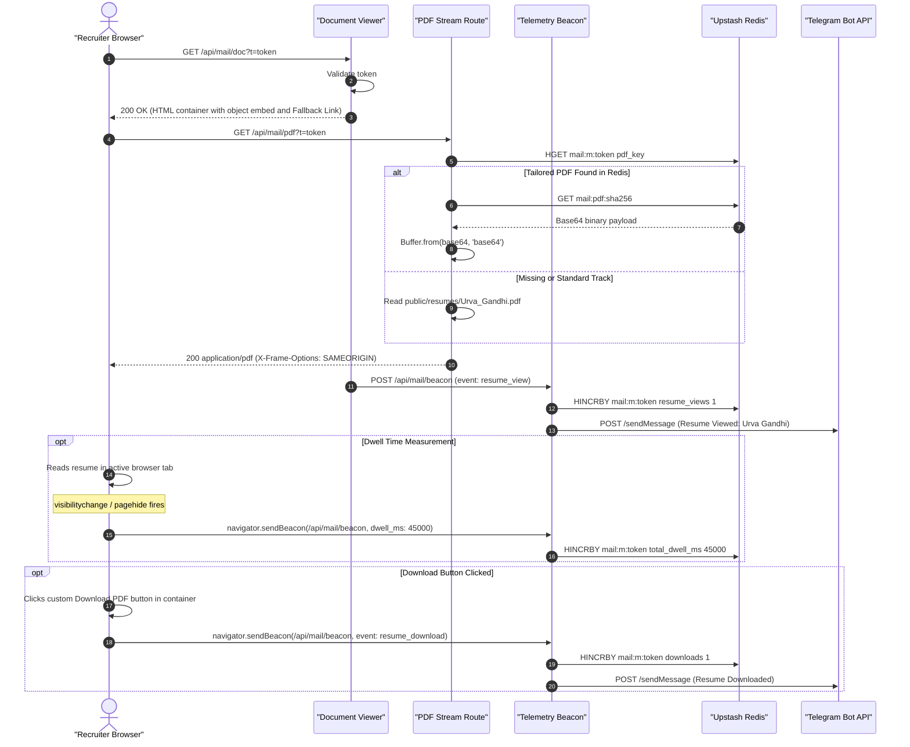
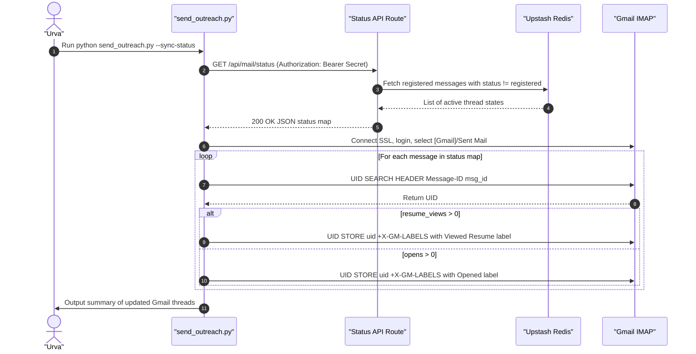
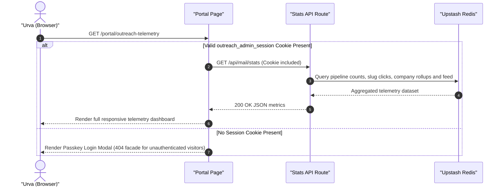
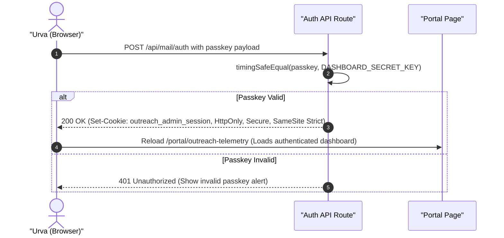

# 04 — User Flows: Mail Tracker

| Field | Value |
|---|---|
| Document | 04-user-flows.md |
| Version | 1.1 (Mermaid Syntax Hardened) |
| Date | 15 Nov 2026 |
| Status | Approved. Formal sequence diagrams and interaction pathways. |
| Notation | Mermaid sequence diagrams with step-by-step state assertions. |

---

## 1. Flow F-01: Outreach Pre-Registration and Transmission Flow

This flow covers message creation in [`send_outreach.py`](file:///Users/urvagandhi/Documents/Resumes/Job_Automation/send_outreach.py), token pre-registration on the portfolio server, tailored PDF caching, email delivery and rollback handling if SMTP fails.

---

## 2. Flow F-02: Recruiter Email Open Flow

This flow details how the 1×1 GIF open beacon is processed, classified and persisted, applying the 5-minute debounce rule for Telegram alerts while maintaining fail-open execution.

---

## 3. Flow F-03: Recruiter Link Click and Redirection Flow

This flow illustrates project and profile showcase click tracking. Link clicks are high-intent events and are **never debounced**.

---

## 4. Flow F-04: Recruiter Resume Viewing Flow (Native Embed & Beacon)

This flow illustrates the web resume experience: serving the HTML container, streaming the PDF binary with frame-ancestor overrides, and recording visible dwell time and download events.

---

## 5. Flow F-05: Gmail IMAP Status Synchronisation Flow

This flow details how `send_outreach.py` fetches outreach milestones and applies visual labels to Gmail Sent threads.

---

## 6. Flow F-06: Private Analytics Dashboard Authentication Flow

This flow illustrates administrative access control for `/portal/outreach-telemetry`, enforcing 404 responses for public visitors.

### 6.1 Initial Route Access and Cookie Validation

### 6.2 Passkey Verification and Session Issuance

