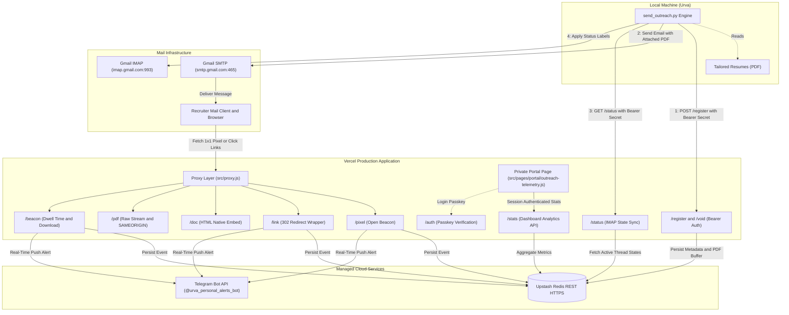
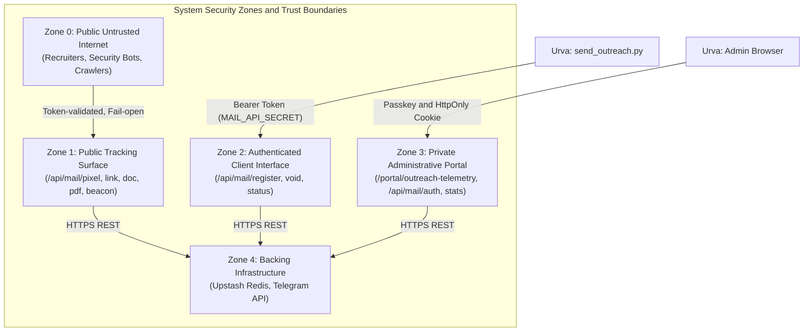
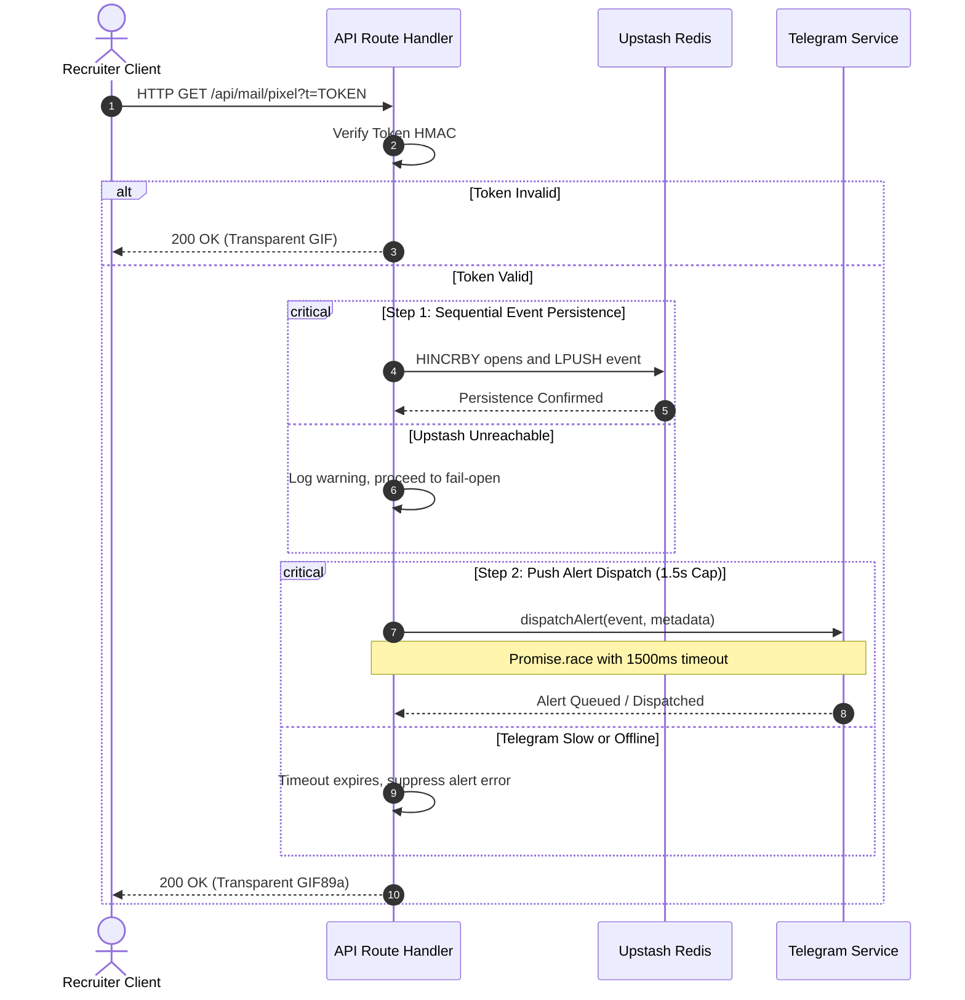

# 05 — System Architecture: Mail Tracker

| Field | Value |
|---|---|
| Document | 05-architecture.md |
| Version | 1.1 (Mermaid Syntax Hardened) |
| Date | 15 Nov 2026 |
| Status | Approved. Formal component architecture, trust boundaries and data pathways. |

---

## 1. Architectural Drivers

| Driver | Architectural Consequence |
|---|---|
| **Host Integration** | Embedded inside the existing portfolio repository ([`urva-portfolio`](file:///Users/urvagandhi/Developer/Personal/urva-portfolio)) on Next.js 16 Pages Router using plain JavaScript. Zero separate backend services. |
| **Fail-Open Resilience** | Public tracking endpoints (`/api/mail/pixel`, `/api/mail/link`, `/api/mail/doc`) must never fail visibly for recruiters. If Redis or Telegram fails, the pixel returns 200 OK and link redirects proceed immediately. |
| **Strict 1.5s Execution Cap** | On incoming telemetry events, Upstash Redis persistence executes first, followed by the Telegram push notification promise. Combined execution terminates within a 1.5-second cap using `Promise.allSettled`. |
| **Proxy & Routing Interception** | [src/proxy.js](file:///Users/urvagandhi/Developer/Personal/urva-portfolio/src/proxy.js) filters all requests. New routes must be added to `knownApiRoutes` (`/api/mail/*`) and `isKnownPath` (`/portal`), bypassing synthetic markdown content negotiation. |
| **UI Shell Decoupling** | [src/pages/_app.js](file:///Users/urvagandhi/Developer/Personal/urva-portfolio/src/pages/_app.js) globally mounts `NavBar`, `Footer`, `Particles`, `CustomCursor`, `Loader` and `@vercel/analytics`. Private portal routes (`/portal/*`) must bypass this global shell. |
| **Free-Tier Boundaries** | Upstash Redis free tier (256 MB storage, 500,000 monthly commands) and Vercel Hobby serverless limits mandate lightweight HTTPS REST commands and zero sub-daily cron jobs. |
| **Multi-Resume Tailoring** | Dynamic caching of 36–41 KB company-tailored PDFs in Redis, deduplicated by SHA-256 hash (`mail:pdf:{sha256}`) with a 180-day TTL and static local file fallback. |

---

## 2. System Context Diagram

---

## 3. Subsystem Breakdown

### 3.1 Proxy and Routing Layer (`src/proxy.js`)
- **Route Whitelisting**: Adds `/api/mail/register`, `/api/mail/void`, `/api/mail/pixel`, `/api/mail/link`, `/api/mail/doc`, `/api/mail/pdf`, `/api/mail/beacon`, `/api/mail/status`, `/api/mail/auth` and `/api/mail/stats` to `knownApiRoutes`.
- **Portal Page Whitelisting**: Adds `/portal` to `isKnownPath`, preventing the crawler markdown trap from intercepting administrative portal visits.
- **Header Injection**: Preserves existing security and CORS headers while permitting `/api/mail/pdf` to emit specific frame ancestor overrides.

### 3.2 Public Tracking Endpoints (`src/pages/api/mail/`)
- **`pixel.js`**: Validates HMAC token, applies 5-minute debounce check on opens, writes event to Redis, dispatches Telegram push alert, and returns a 42-byte transparent GIF89a.
- **`link.js`**: Validates HMAC token, verifies slug against allowlist, logs click to Redis and Redis sorted set (`mail:stats:slug_clicks`), dispatches immediate Telegram alert, and issues HTTP 302 redirect.
- **`doc.js`**: Serves a fast HTML container embedding `/api/mail/pdf?t=<token>` via native `<object>` tag with fallback direct link and dwell time beacon scripts.
- **`pdf.js`**: Resolves `pdf_key` from Redis. Decodes Base64 buffer or falls back to static `public/resumes/Urva_Gandhi.pdf`. Emits `X-Frame-Options: SAMEORIGIN` and `Content-Security-Policy: frame-ancestors 'self'`.
- **`beacon.js`**: Collects visibility duration (`dwell_ms`) and custom download button clicks, accumulating dwell time in Redis.

### 3.3 Administrative & Sync Endpoints (`src/pages/api/mail/`)
- **`register.js`**: Authenticated with `MAIL_API_SECRET`. Generates cryptographically secure 16-byte random token and HMAC signature, computes SHA-256 for tailored PDFs, stores binary buffer with 180-day TTL, and initializes Message Record with 60-day TTL.
- **`void.js`**: Authenticated rollback endpoint marking registered records as `voided` if local SMTP transmission encounters an error.
- **`status.js`**: Authenticated endpoint returning RFC 822 Message-ID mapping for Gmail IMAP label synchronisation.
- **`auth.js`**: Validates passkey against `DASHBOARD_SECRET_KEY` using `crypto.timingSafeEqual` and sets an `HttpOnly`, `Secure`, `SameSite=Strict` session cookie.
- **`stats.js`**: Session-authenticated analytics API querying pipeline counts, open rates, company rollups and recent activity feeds.

### 3.4 Data Access Layer (`src/lib/mail/`)
- **`redis.js`**: Zero-dependency client communicating with Upstash Redis via native `fetch()` over HTTPS REST (`UPSTASH_REDIS_KV_REST_API_URL`). Implements environment prefixing (`preview:` vs `prod:`).
- **`token.js`**: Token generation, signing and HMAC verification routines.
- **`telegram.js`**: Notification formatting in IST with HTML parse mode, handling connection timeouts (1.5-second cap).
- **`allowlist.js`**: Immutable map of permitted showcase link slugs.

### 3.5 UI Layer (`src/pages/portal/outreach-telemetry.js`)
- Dedicated administrative React page reusing portfolio theme tokens (`Layout`, `Seo`).
- Injects `Seo({ noindex: true, nofollow: true })` and emits `X-Robots-Tag: noindex, nofollow, noarchive`.
- Excluded from static generation in [next-sitemap.config.js](file:///Users/urvagandhi/Developer/Personal/urva-portfolio/next-sitemap.config.js).

---

## 4. Trust Boundaries and Security Zones

### Trust Boundary Rules
1. **Zone 0 -> Zone 1 (Public Tracking)**:
   - Untrusted inbound traffic.
   - Tokens verified via HMAC-SHA256. Invalid or missing tokens fail open (return 200 GIF or redirect).
   - Zero recruiter PII accepted in query parameters.
   - Arbitrary redirect parameters (`?to=...`) discarded.
2. **Local Machine -> Zone 2 (Client Interface)**:
   - Protected by high-entropy `MAIL_API_SECRET` passed in `Authorization: Bearer <secret>`.
   - Rejects unauthenticated calls with RFC 9457 401 Unauthorized.
3. **Admin Browser -> Zone 3 (Portal)**:
   - Gated by `DASHBOARD_SECRET_KEY` via constant-time comparison.
   - Session authenticated via `HttpOnly`, `Secure`, `SameSite=Strict` cookie.
   - Unauthenticated public requests receive an HTTP 404 response.
4. **Vercel Functions -> Zone 4 (Cloud Infrastructure)**:
   - Communicates over TLS 1.3 to Upstash Redis REST and Telegram Bot API.
   - All credentials loaded strictly from Vercel Environment Variables.

---

## 5. Sequence Architecture: Resilient Telemetry Pipeline

