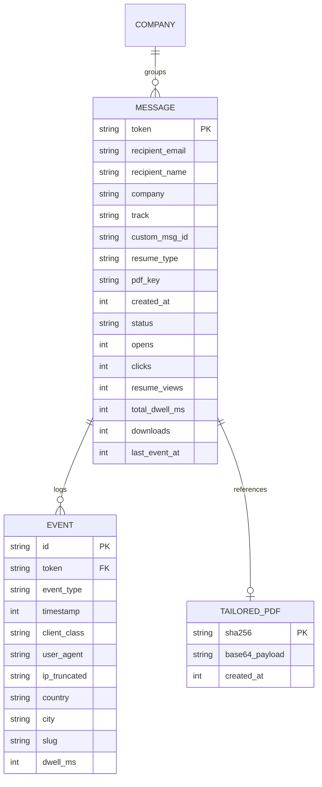

# 06 — Data Design: Mail Tracker

| Field | Value |
|---|---|
| Document | 06-data-design.md |
| Version | 1.0 (Approved Baseline) |
| Date | 15 Nov 2026 |
| Datastore | Upstash Redis (Vercel Integration over HTTPS REST) |
| Status | Approved. Formal key schemas, data types, TTL rules and capacity models. |

---

## 1. Storage Principles and Dual Retention Policy

1. **Stateless HTTP REST**: All Redis operations execute over stateless HTTPS REST calls (`fetch`) using `@upstash/redis` or direct JSON REST commands, eliminating connection pooling issues in serverless cold starts.
2. **Environment Prefix Isolation**: A single helper function `k(name)` prefixes all Redis keys with `preview:` when `process.env.VERCEL_ENV !== 'production'`, enabling preview deployments to share the single free database without corrupting production metrics.
3. **Dual TTL Retention Model**:
   - **Telemetry Records (60-Day TTL)**: Message records, event lists, debounce keys and daily counters expire automatically after **60 days** (5,184,000 seconds), satisfying DPDP Act 2023 and GDPR storage minimisation.
   - **Tailored PDF Binaries (180-Day TTL)**: Cached PDF binaries expire after **180 days** (15,552,000 seconds), ensuring recruiter bookmark links and shared resume URLs do not fail prematurely while hiring pipelines are active.
4. **Content-Addressed PDF Deduplication**: Tailored resumes are indexed by their SHA-256 hash (`mail:pdf:{sha256}`). If multiple recruiters at the same organisation (e.g. Barclays, Akamai) receive outreach with identical resumes, the binary is stored once.
5. **Privacy IP Truncation**: Client IPv4 addresses are truncated to the first three octets (e.g. `192.168.1.xxx`) and IPv6 addresses are truncated to `/48` prefixes prior to persistence.

---

## 2. Logical Data Model



---

## 3. Physical Redis Key Schema

### 3.1 Message Record: `mail:m:{token}`
- **Data Type**: Hash
- **TTL**: 5,184,000 seconds (60 days)
- **Fields**:

| Field Name | Type | Description | Example |
|---|---|---|---|
| `token` | String | 32-character hex token identifier | `7f83b165c92e...` |
| `recipient_email` | String | Target recruiter email address | `recruiter@company.com` |
| `recipient_name` | String | Target recruiter full name or greeting | `Sarah Jenkins` |
| `company` | String | Company or organisation name | `Akamai` |
| `track` | String | Outreach role track (`generic`, `java`, `ai`, `intern`) | `java` |
| `custom_msg_id` | String | Client-generated RFC 822 Message-ID | `<20261115120000.12345@gmail.com>` |
| `resume_type` | String | `tailored` or `standard` | `tailored` |
| `pdf_key` | String | Reference key to cached PDF binary | `mail:pdf:a3f891...` |
| `created_at` | Integer | Epoch timestamp in milliseconds | `1794697200000` |
| `status` | String | `registered`, `opened`, `clicked`, `resume_viewed`, `voided` | `opened` |
| `opens` | Integer | Cumulative open beacon count | `3` |
| `clicks` | Integer | Cumulative project showcase click count | `1` |
| `resume_views` | Integer | Cumulative web resume viewer sessions | `1` |
| `total_dwell_ms`| Integer | Total active tab dwell duration in milliseconds | `48200` |
| `downloads` | Integer | Custom download button click count | `1` |
| `last_event_at` | Integer | Timestamp of most recent interaction | `1794697350000` |

---

### 3.2 Deduplicated Tailored PDF: `mail:pdf:{sha256}`
- **Data Type**: String (raw Base64 string)
- **TTL**: 15,552,000 seconds (180 days)
- **Key Pattern**: `mail:pdf:7f83b165...` (64-character SHA-256 hex)
- **Payload**: Base64-encoded PDF binary (~48 KB to 55 KB for 36–41 KB compiled PDFs).
- **Behaviour**: During `POST /api/mail/register`, if `EXISTS mail:pdf:{sha256}` returns 1, the write is skipped and `EXPIRE` is refreshed to 180 days.

---

### 3.3 Event Telemetry Log: `mail:events:{token}`
- **Data Type**: List (JSON string items)
- **TTL**: 5,184,000 seconds (60 days)
- **Item Schema**:
```json
{
  "event": "open | click | resume_view | beacon_dwell | download",
  "ts": 1794697250000,
  "client_class": "apple_mpp | gmail_proxy | direct_unclassified",
  "ua": "Mozilla/5.0 (Macintosh; Intel Mac OS X 10_15_7)...",
  "ip_trunc": "104.28.212.xxx",
  "country": "US",
  "region": "CA",
  "city": "San Jose",
  "slug": "cointrack",
  "dwell_ms": 12500
}
```

---

### 3.4 Open Debounce State: `mail:debounce:open:{token}:{client_class}`
- **Data Type**: String
- **TTL**: 300 seconds (5 minutes)
- **Value**: `"1"`
- **Accompanying Counter**: `mail:debounce:count:{token}:{client_class}` (Integer, incremented during active debounce).

---

### 3.5 Global Indices and Aggregates

| Key Name | Data Type | TTL | Description |
|---|---|---|---|
| `mail:index:messages` | Set | None (or rolling) | Set of all active message tokens for iteration |
| `mail:index:company:{company_slug}` | Set | 60 days | Set of tokens belonging to a specific company |
| `mail:stats:slug_clicks` | Sorted Set | 60 days | Member: `slug`, Score: cumulative click count |
| `mail:stats:daily:{YYYY-MM-DD}` | Hash | 60 days | Aggregate daily counts (`sent`, `opened`, `clicks`, `resume_views`) |

---

## 4. Key Prefixing & Environment Isolation Pattern

All key lookups and writes are passed through an environment wrapper in `src/lib/mail/redis.js`:

```javascript
export function k(keyName) {
  const env = process.env.VERCEL_ENV || process.env.NODE_ENV || 'development';
  if (env !== 'production') {
    return `preview:${keyName}`;
  }
  return keyName;
}
```

This guarantees preview deployments writing `preview:mail:m:{token}` cannot interfere with production analytics or trigger false alerts.

---

## 5. Storage Capacity and Free-Tier Quota Model

| Resource | Free-Tier Quota | Estimated Usage (500 Sends / 60 Days) | % Quota Consumed |
|---|---|---|---|
| **Redis Storage** | 256 MB | 500 Messages × 1.2 KB = 600 KB<br>100 Tailored PDFs × 52 KB = 5.2 MB<br>**Total: ~5.8 MB** | **2.26%** |
| **Max Record Size** | 100 MB | Largest tailored PDF Base64: **55 KB** | **0.05%** |
| **Max Request Size** | 10 MB | Registration payload with PDF: **~60 KB** | **0.60%** |
| **Monthly Commands** | 500,000 / month | 15 sends/day = ~60 commands/day = **~1,800 / month** | **0.36%** |

The system operates comfortably below 3% of all free-tier limits, ensuring zero risk of account throttling or storage overage.
