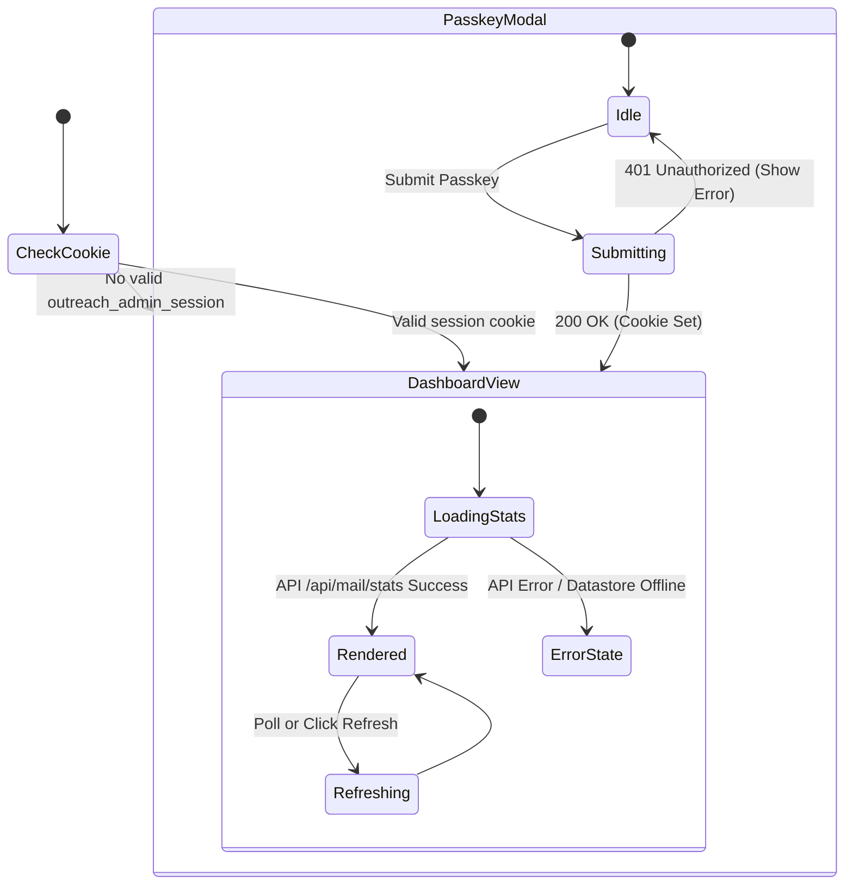

# 08 — UI/UX Specification: Mail Tracker

| Field | Value |
|---|---|
| Document | 08-ui-ux.md |
| Version | 1.0 (Approved Baseline) |
| Date | 15 Nov 2026 |
| Target Route | `/portal/outreach-telemetry` (`src/pages/portal/outreach-telemetry.js`) |
| Status | Approved. Formal layout, visual tokens, state machines and responsiveness. |

---

## 1. Design Principles and Integration

1. **Portfolio Cohesion**: Reuses the portfolio's native Tailwind CSS tokens, Lucide-react iconography, dark theme (`bg-slate-950` / `bg-slate-900`) and typography (`Inter` / system sans).
2. **UI Shell Decoupling**: The administrative portal must **not** render the consumer portfolio header, footer, interactive particle background or custom animated cursor. [src/pages/_app.js](file:///Users/urvagandhi/Developer/Personal/urva-portfolio/src/pages/_app.js) is decoupled for `/portal/*` routes to eliminate splash delays and UI pollution.
3. **Search Engine & Visitor Cloaking**: The page injects `Seo({ noindex: true, nofollow: true })` and emits `X-Robots-Tag: noindex, nofollow, noarchive`. Public visitors accessing the route without administrative context encounter an HTTP 404 response.

---

## 2. Page States and Views



---

## 3. View 1: Administrative Passkey Modal (Unauthenticated State)

When accessed by the owner without an active session cookie:
- **Card Container**: Centred dark elevation card (`max-w-md bg-slate-900 border border-slate-800 rounded-xl p-8 shadow-2xl`).
- **Header**: Lock icon (`lucide-react/Lock`), title `"Telemetry Authentication"`, subtitle `"Enter security passkey to access outreach metrics."`.
- **Input Field**: Password input with dark background (`bg-slate-950 border border-slate-700 text-white placeholder-slate-500 rounded-lg px-4 py-3 focus:border-cyan-500 focus:outline-none`).
- **Action Button**: Primary cyan button (`bg-cyan-500 hover:bg-cyan-400 text-slate-950 font-semibold py-3 rounded-lg transition-colors`), showing loading spinner on submit.
- **Error Feedback**: Red alert banner (`bg-rose-950/50 border border-rose-800 text-rose-300 text-sm p-3 rounded-lg`) on 401 response.

---

## 4. View 2: Outreach Telemetry Dashboard (Authenticated State)

### 4.1 Header Bar
- **Left**: Title `"Outreach Telemetry & Recruiter Engagement"`, with real-time status pulse dot (Green: Connected).
- **Right**:
  - Live clock display: `Asia/Kolkata (IST)` (e.g. `15 Nov 2026, 17:30 IST`).
  - Refresh Button: Dispatches re-fetch of `/api/mail/stats`.
  - Logout Button: Clears `outreach_admin_session` cookie and resets view.

---

### 4.2 Top Metric Summary Cards (4-Column Grid)

```
┌──────────────────┐ ┌──────────────────┐ ┌──────────────────┐ ┌──────────────────┐
│ Total Outreach   │ │ Recruiter Opens  │ │ Resume Views     │ │ Project Clicks   │
│ 142              │ │ 98 (69.0%)       │ │ 44               │ │ 31               │
│ Registered Sends │ │ Verified Reads   │ │ Avg Dwell: 42s   │ │ Showcase Hops    │
└──────────────────┘ └──────────────────┘ └──────────────────┘ └──────────────────┘
```

1. **Total Outreach Dispatched**:
   - Primary metric: Total registered messages (`status != "voided"`).
   - Subtitle: `Registered Sends via send_outreach.py`.
2. **Recruiter Opens**:
   - Primary metric: Count of opened emails + calculated Open Rate (`(opened / total) * 100`).
   - Badge: Direct Opens vs Proxy Opens count.
3. **Resume Views**:
   - Primary metric: Total web resume viewer sessions.
   - Subtitle: `Average Tab Dwell: XXs` + download counts.
4. **Project Showcase Clicks**:
   - Primary metric: Total 302 redirects logged.
   - Subtitle: Clicks on CoinTrack, FleetFlow, Paperpal, etc.

---

### 4.3 Middle Section: Split Analytics (2-Column Grid)

#### Column 1: Showcase Link Leaderboard
- Displays horizontal bar chart / distribution list for allowlisted slugs:
  - **CoinTrack** (`cointrack` + `cointrack_gh`): 18 clicks (58%)
  - **Agent Paperpal** (`paperpal` + `paperpal_gh`): 9 clicks (29%)
  - **FleetFlow** (`fleetflow` + `fleetflow_gh`): 4 clicks (13%)
  - **GitHub Profile** (`github`): 12 clicks
  - **LinkedIn Profile** (`linkedin`): 8 clicks

#### Column 2: Company-Level Rollup Table
- Collapsible data table aggregating recruiters by organisation:

| Company | Outreach Sent | Opened | Resume Viewed | Clicks | Last Active (IST) |
|---|---|---|---|---|---|
| **Akamai** | 4 | 3 | 2 | 3 | 15 Nov, 16:42 |
| **Barclays** | 6 | 4 | 3 | 2 | 15 Nov, 15:10 |
| **BlackRock** | 3 | 1 | 0 | 0 | 14 Nov, 19:20 |
| **Citi** | 2 | 2 | 1 | 1 | 14 Nov, 14:05 |

---

### 4.4 Bottom Section: Real-Time Recruiter Engagement Feed

A reverse-chronological event table displaying verified recruiter interactions:

| Recruiter & Company | Event Type & Classification | Detail / Context | Location & Device | Timestamp (IST) | Score |
|---|---|---|---|---|---|
| **Sarah Jenkins**<br>`recruiter@akamai.com`<br>Akamai | `Resume Viewed`<br>`[Direct Open (Unclassified)]` | Tailored Akamai PDF<br>Dwell: **48s** · Downloaded | San Jose, US<br>Macintosh · Chrome | 15 Nov, 17:15 | `9` (High) |
| **Priya Sharma**<br>`talent@barclays.com`<br>Barclays | `Link Clicked`<br>`[Verified Human]` | **CoinTrack** (Live Demo)<br>Destination: `cointrack-finance...` | Pune, IN<br>Windows · Edge | 15 Nov, 16:50 | `4` (Med) |
| **David Miller**<br>`dmiller@citi.com`<br>Citi | `Email Opened`<br>`[Gmail Proxy Open]` | Open #1<br>Track: `Java Backend` | Google Proxy<br>GoogleImageProxy | 15 Nov, 15:30 | `1` (Low) |
| **Recruiter Lead**<br>`hr@apple.com`<br>Apple | `Email Opened`<br>`[⚠️ Apple MPP Prefetch]` | Open #1 (Automated)<br>Track: `SWE` | Apple Relay<br>bare `Mozilla/5.0` | 15 Nov, 14:12 | `0` (Bot) |

#### Recruiter Engagement Score Algorithm
- Open: `+1 point` (excluded for Apple MPP prefetch)
- Second / Repeated Open: `+1 point`
- Showcase Link Click: `+3 points` per distinct slug
- Resume Web View: `+5 points`
- Resume Dwell Time > 30s: `+2 bonus points`
- Resume Download Button Click: `+3 points`
- **Total Score Thresholds**: High (≥ 8), Medium (3–7), Low (1–2), Automated/None (0).

---

## 5. Responsive Breakpoint Matrix

| Viewport | Top Cards | Middle Section | Engagement Feed |
|---|---|---|---|
| **Desktop (≥ 1280px)** | 4 Cards across | 2 Columns side-by-side | Full 6-column tabular view |
| **Tablet (768px – 1279px)** | 2 × 2 Grid | Stacked vertically | 5 Columns (location combined) |
| **Mobile (< 768px)** | 1 Column vertical stack | Stacked vertically | Card list replacing table for touch readability |
