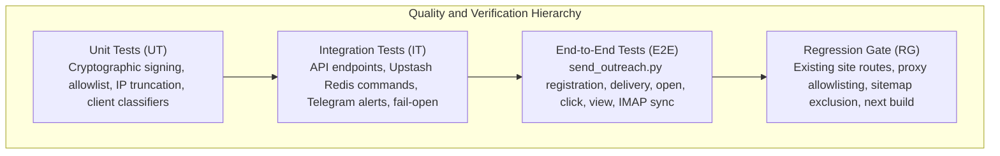

# 10 — Testing Strategy & Quality Assurance: Mail Tracker

| Field | Value |
|---|---|
| Document | 10-testing-strategy.md |
| Version | 1.0 (Approved Baseline) |
| Date | 15 Nov 2026 |
| Target Harness | Native Node.js Test Harness (`scripts/test-mail-tracker.js`) |
| Status | Approved. Formal test matrices, assertions, regression gates and verification protocols. |

---

## 1. Testing Philosophy & Zero-Dependency Framework

1. **Alignment with Codebase Conventions**: The repository currently contains no third-party test runners (Jest, Vitest). [scripts/verify-agent-readiness.js](file:///Users/urvagandhi/Developer/Personal/urva-portfolio/scripts/verify-agent-readiness.js) establishes a proven, zero-dependency Node.js HTTP assertion test suite pattern.
2. **Native Node.js Runner**: Tests will execute via a custom test runner script (`scripts/test-mail-tracker.js`) utilizing Node.js built-in `node:assert`, `node:crypto` and native `fetch()`. Zero new npm packages are installed for testing.
3. **Strict Non-Pollution Rule**: Automated tests and manual verifications shall execute strictly against personal test email inboxes (`study.urva@gmail.com`), never real recruiter addresses.
4. **Environment Isolation**: In non-production environments (`VERCEL_ENV !== 'production'`), the datastore client automatically prefixes all keys with `preview:`, preventing test runs from corrupting live metrics.

---

## 2. Test Classification Matrix



---

## 3. Unit Test Specifications (UT)

| Test ID | Module | Target Function | Test Scenario & Assertion | Expected Result |
|---|---|---|---|---|
| **UT-01** | `token.js` | `generateToken()` | Generate token; verify format matches `<32hex>.<32hex>` with valid HMAC-SHA256 signature. | Returns valid 65-char token string. |
| **UT-02** | `token.js` | `verifyToken()` | Pass tampered signature or truncated string to `verifyToken()`. | Returns `false`. |
| **UT-03** | `allowlist.js` | `resolveDestination()` | Query `cointrack`, `fleetflow`, `paperpal`, `github`, `linkedin`, `portfolio` and repo slugs. | Returns exact target destination URLs. |
| **UT-04** | `allowlist.js` | `resolveDestination()` | Pass arbitrary target (`http://evil.com`) or unknown slug (`unknown_app`). | Returns `null` (rejects open redirect). |
| **UT-05** | `classifier.js` | `classifyClient()` | Pass bare `Mozilla/5.0` User-Agent string. | Returns `apple_mpp`. |
| **UT-06** | `classifier.js` | `classifyClient()` | Pass User-Agent containing `GoogleImageProxy`. | Returns `gmail_proxy`. |
| **UT-07** | `classifier.js` | `classifyClient()` | Pass standard browser User-Agent (Chrome, Safari, Firefox). | Returns `direct_unclassified`. |
| **UT-08** | `privacy.js` | `truncateIp()` | Pass `192.168.1.145` and `2001:db8:85a3::8a2e`. | Returns `192.168.1.xxx` and `2001:db8:85a3:xxxx`. |
| **UT-09** | `redis.js` | `k()` | Execute with `VERCEL_ENV=preview` vs `VERCEL_ENV=production`. | Returns `preview:mail:m:...` vs `mail:m:...`. |
| **UT-10** | `contact.js` | `escapeHtml()` | Pass `<script>alert(1)</script>&"message'`. | Returns `&lt;script&gt;alert(1)&lt;/script&gt;&amp;&quot;message&#39;`. |

---

## 4. Integration Test Specifications (IT)

| Test ID | Endpoint | Method | Precondition / Payload | Assertion & Verification |
|---|---|---|---|---|
| **IT-01** | `/api/mail/register` | `POST` | Bearer auth + valid metadata (`email`, `company`, `track`, `custom_msg_id`). | `201 Created` + returns JSON with `token`, `pixel_url`, `doc_url` and 10 wrapped link URLs. |
| **IT-02** | `/api/mail/register` | `POST` | Bearer auth + tailored Base64 PDF payload. | Computes SHA-256; stores binary in Redis `mail:pdf:{sha256}` with 180-day TTL. |
| **IT-03** | `/api/mail/register` | `POST` | Missing or invalid Bearer secret. | `401 Unauthorized` (RFC 9457 Problem Details). |
| **IT-04** | `/api/mail/void` | `POST` | Bearer auth + `{ token: "..." }`. | `200 OK` + updates Redis message status to `"voided"`. |
| **IT-05** | `/api/mail/pixel` | `GET` | Valid `t=<token>`. | `200 OK`, `image/gif`, 42 bytes, `Cache-Control: no-store`; increments Redis `opens`. |
| **IT-06** | `/api/mail/pixel` | `GET` | Rapid duplicate calls (<5 min, same client class). | Events persisted in Redis; Telegram alert debounced (`+N more`). |
| **IT-07** | `/api/mail/pixel` | `GET` | Missing or invalid `t` query param (Fail-Open). | `200 OK`, 42 bytes GIF returned; zero Redis events logged. |
| **IT-08** | `/api/mail/link` | `GET` | Valid `t` and `slug=cointrack`. | `302 Found`, `Location: https://cointrack-finance.vercel.app/`; increments Redis `clicks`. |
| **IT-09** | `/api/mail/link` | `GET` | Valid `t` and unknown `slug=malicious`. | `404 Not Found` Problem Details; zero redirection. |
| **IT-10** | `/api/mail/doc` | `GET` | Valid `t=<token>`. | `200 OK`, HTML container served with `<object>` embed and "Open PDF" direct link. |
| **IT-11** | `/api/mail/pdf` | `GET` | Valid `t=<token>` for tailored resume. | `200 OK`, `application/pdf`, `X-Frame-Options: SAMEORIGIN`, streams raw PDF buffer. |
| **IT-12** | `/api/mail/pdf` | `GET` | Valid `t` where Redis binary is missing. | Logs warning, falls back gracefully to `Urva_Gandhi.pdf`. |
| **IT-13** | `/api/mail/beacon`| `POST` | Valid `t` + `{ dwell_ms: 32000, event: "resume_view" }`. | `204 No Content`; accumulates dwell time in Redis. |
| **IT-14** | `/api/mail/status`| `GET` | Bearer auth. | `200 OK` + returns RFC 822 Message-ID mapping for IMAP sync. |
| **IT-15** | `/api/mail/auth` | `POST` | Valid passkey payload matching `DASHBOARD_SECRET_KEY`. | `200 OK` + sets `outreach_admin_session` HttpOnly cookie. |
| **IT-16** | `/api/mail/auth` | `POST` | Invalid passkey payload. | `401 Unauthorized`. |
| **IT-17** | `/api/mail/stats` | `GET` | Valid session cookie. | `200 OK` + JSON metrics (sent, opens, clicks, rollups, feed). |
| **IT-18** | `/portal/outreach-telemetry` | `GET` | No session cookie. | `404 Not Found` response. |

---

## 5. End-to-End Workflow Verification (E2E)

Executed using a local dry-run script transmitting to `study.urva@gmail.com`:

```
┌────────────────────────────────────────────────────────────────────────┐
│                   END-TO-END VERIFICATION FLOW                        │
└────────────────────────────────────────────────────────────────────────┘

 1. Script Pre-registration
    send_outreach.py --dry-run calls POST /api/mail/register
    Assert: Token returned, Redis record created with status="registered"

 2. Email Transmission
    SMTP sends message to study.urva@gmail.com
    Assert: Message delivered with physical PDF attached & Message-ID stamped

 3. Recruiter Engagement Simulation
    a. Fetch pixel URL -> Assert: 42-byte GIF, open logged in Redis, Telegram alert received
    b. Click CoinTrack link -> Assert: 302 to cointrack-finance..., Telegram click alert received
    c. Open resume URL -> Assert: HTML container rendered, PDF streamed with SAMEORIGIN headers
    d. Simulate 30s dwell -> Assert: /api/mail/beacon updates dwell time in Redis

 4. IMAP Label Synchronisation
    send_outreach.py --sync-status
    Assert: IMAP searches Sent Mail, tags thread with "✓ Viewed Resume" and "✓✓ Opened"

 5. Dashboard Inspection
    Owner logs into /portal/outreach-telemetry with passkey
    Assert: Overview cards, company rollup and feed show test interaction accurately
```

---

## 6. Regression Testing Gate (RG)

Before any deployment to production, the regression harness confirms:

1. **RG-01 Core Portfolio Routes**:
   - `GET /` -> 200 OK (HTML)
   - `GET /about` -> 200 OK (HTML)
   - `GET /projects` -> 200 OK (HTML)
   - `GET /contact` -> 200 OK (HTML)
   - `GET /privacy` -> 200 OK (HTML, updated with recruitment telemetry notice)
2. **RG-02 Proxy Content Negotiation**:
   - `GET /` with `User-Agent: curl/8.4.0` -> 200 OK Markdown document.
   - `GET /api/mail/pixel` with `User-Agent: curl/8.4.0` -> 200 OK Binary GIF (bypasses markdown trap).
3. **RG-03 SEO and Discovery Artifacts**:
   - `GET /robots.txt` -> 200 OK.
   - `GET /sitemap.xml` -> 200 OK (Confirms `/portal/*` is excluded).
   - `GET /api/mcp` -> 200 OK (MCP server manifest intact).
   - `GET /openapi.json` -> 200 OK (API docs intact).
4. **RG-04 Build and Lint Cleanliness**:
   - `npm run lint` -> 0 errors, 0 warnings.
   - `npm run build` -> Clean compile, successful `next-sitemap` postbuild.
